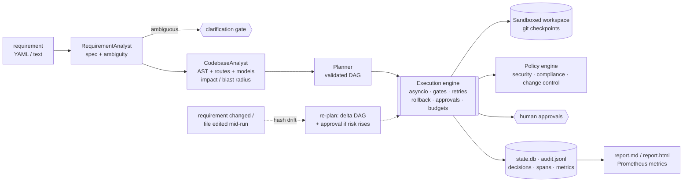

# Agentic SDLC Orchestrator + URL Shortener

An **agentic SDLC orchestration engine** that takes a requirement (YAML or free text) and plans and executes the
lifecycle (requirements → design → implementation → tests → docs → release readiness) as a stateful, governed,
non-linear DAG of agent tasks. Every node passes entry/exit gates (lint, tests, coverage, typecheck, migrations)
and policy-as-code checks (security, compliance, change control). Risky changes stop at human approval gates.
Failed attempts are rolled back and retried with the failure as feedback, and a run re-plans itself when its
inputs change. Everything goes to a hash-chained audit log with decision lineage. To prove it works, the
orchestrator **built the URL shortener in this repo**: a production-minded FastAPI service with analytics, expiry,
caching, rate limiting, API-key auth and Prometheus metrics. Its code and tests are byte-identical to what
three committed orchestrator runs produced ([`runs/`](runs/README.md)).

No API key needed: the default deterministic provider makes every demo, test and CI run reproducible offline.
Set `ANTHROPIC_API_KEY` to drive the same agents with Claude.



## Quickstart (no API key)

```bash
make setup          # uv venv + all deps (installs Python 3.12 via uv if needed)
make demo           # greenfield -> brownfield -> ambiguous, ~45 s, prints a summary table
make check          # ruff + mypy --strict + 285 tests (coverage gates) + bandit + pip-audit
make run            # the URL shortener on http://localhost:8000 (SQLite), docs at /docs
```

Create an API key for write calls: `uv run python -m service.cli create-key --name me`.

## Running each scenario

| Command | What it shows |
|---|---|
| `make scenario-greenfield` | Full decomposition from an empty workspace; parallel implement branches; tests + docs in parallel, joined at review; gates; release readiness |
| `make scenario-brownfield` | Impact analysis; red-first regression test; naive fix fails → rollback → self-repair retry; migration approval gate |
| `make scenario-ambiguous` | Ambiguity detection + clarification; mid-run requirement change → **dynamic re-plan**; high-risk auth gate blocks until approved |
| `make demo` | All three chained in one workspace with `--auto-approve=low,medium --i-understand-high-risk` |

Scenarios auto-approve `low,medium` by default (`APPROVE=` overrides, e.g. `make scenario-brownfield APPROVE=--auto-approve=low`).
High-risk gates are **never** auto-approved without the explicit flag.

## Approving gates

```bash
orchestrator status <run_id>                         # nodes + pending approvals
orchestrator approve <run_id> '<gate_id>' --comment "reviewed diff"   # identity: ORCH_APPROVER or git user.email
orchestrator reject  <run_id> '<gate_id>' --comment "use a constant-time compare"   # rollback + retry with this feedback
orchestrator resume  <run_id>                        # continue (also after a crash or safe-stop)
orchestrator stop    <run_id>                        # kill switch -> SAFE_STOPPED, state persisted
```

`--interactive` prompts in the terminal instead. Run `orchestrator --help` for the full list (`run`, `scenario`,
`demo`, `audit verify`, `metrics`, `report`, `trace`, `sync`, `verify-lineage`).

## Viewing reports

Every run writes `runs/<run_id>/report.html` (self-contained: SVG DAG + timeline, gates, policies, approvals,
decisions, re-plans, metrics) and `report.md`. Also:

```bash
orchestrator audit verify <run_id>                   # tamper check of the hash chain
orchestrator trace <run_id> service/links.py:120     # line -> commit -> node -> decision chain -> requirement
orchestrator metrics [--format prometheus]           # success/retry/rollback/fallback rates, MTTR, latency
```

## Running with Claude

```bash
export ANTHROPIC_API_KEY=...            # provider auto-switches to "anthropic"; model via ORCH_MODEL (default claude-opus-5-5)
orchestrator scenario greenfield --provider anthropic
orchestrator scenario greenfield --provider record   # record real responses into fixtures/ for replay tests
```

Agents send their typed contract's JSON schema and validate replies with Pydantic. Any provider error, invalid
output or exhausted token budget **falls back to the deterministic provider**, and the fallback is recorded.

## Docker

```bash
make docker-up && bash scripts/smoke.sh http://localhost:8000   # service + Postgres 16 + Redis 7
```

The image is multi-stage, runs as a non-root user, and installs only the service's pinned dependencies
(`requirements.service.txt`). Migrations run as an explicit step before the server starts.

## Project layout

```
orchestrator/   engine, dag, state, audit, tracing, metrics, gates, approvals, controls, workspace,
                policy/ (engine + checks), agents/ (9 roles), providers/ (anthropic, deterministic,
                record/replay), analysis/ (static analysis), blueprints/ (deterministic domain knowledge), cli, report
service/        URL shortener (FastAPI app, domain, repository, analytics, cache, rate limit, auth, migrations)
tests/          orchestrator/ (engine, controls, policies, providers, e2e scenarios) and service/
policies/       autonomy.yaml, security.yaml, compliance.yaml, change_control.yaml
requirements/   greenfield.yaml, brownfield.yaml, ambiguous.txt (+ ambiguous.events.yaml)
runs/           committed evidence of the three scenario runs
fixtures/       record/replay LLM fixtures
scripts/        loadcheck.py (p50/p95 redirect latency), smoke.sh (compose smoke test)
docs/           see below
```

## Documentation

| Doc | Contents |
|---|---|
| [ENGINEERING_SUMMARY](docs/ENGINEERING_SUMMARY.md) | Plan, artifacts, trade-offs, and a requirement → code → test → evidence mapping table |
| [ARCHITECTURE](docs/ARCHITECTURE.md) | Components, state machine, control/data flow, sequence diagram, governance, scaling path |
| [DECISIONS](docs/DECISIONS.md) | 17 ADRs |
| [SCENARIOS](docs/SCENARIOS.md) | Each scenario: input, spec, DAG, timeline, gates, retries/re-plans, outputs |
| [TESTING](docs/TESTING.md) | Test pyramid, what each suite proves, coverage |
| [RISKS](docs/RISKS.md) · [SECURITY](docs/SECURITY.md) | Risk register; STRIDE-lite threat model and controls |
| [OPERATIONS](docs/OPERATIONS.md) · [PERFORMANCE](docs/PERFORMANCE.md) | Config, runbook, alerts; latency method and results |
| [ASSUMPTIONS](docs/ASSUMPTIONS.md) · [LIMITATIONS](docs/LIMITATIONS.md) | What was assumed; what is simplified and what production would need |
| [BUILD_LOG](docs/BUILD_LOG.md) · [CHANGELOG](CHANGELOG.md) | How this was built, what broke, how it was fixed |
| [service README](docs/service/README.md) · [API](docs/service/API.md) · [OpenAPI](docs/openapi.json) | Generated by the DocWriter agent |
