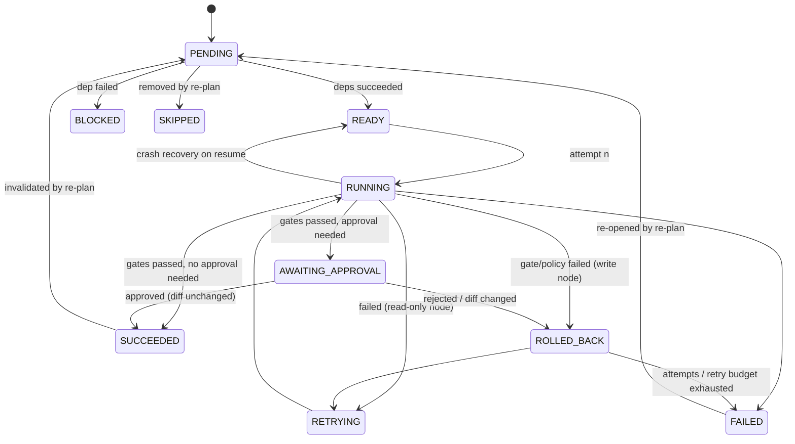
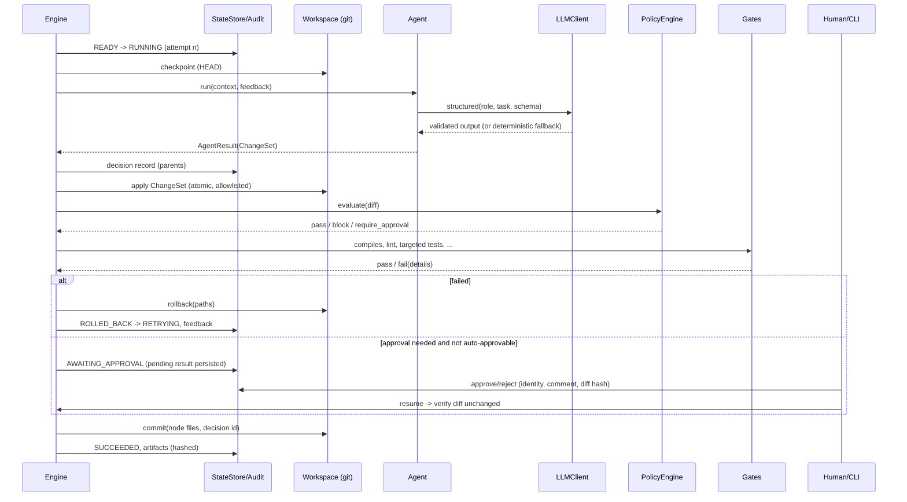

# Architecture

Two layers: **Layer A** (`orchestrator/`) is the agentic SDLC engine; **Layer B** (`service/`) is the URL
shortener it built. This document covers Layer A in depth and Layer B briefly.

## 1. Components (Layer A)

| Component | Module | Responsibility |
|---|---|---|
| Domain model | `models.py` | Typed `TaskNode`, `PlanDAG`, `DeltaPlan`, `RequirementSpec`, `ChangeSet`, `Decision`, `ApprovalRequest`… and the **legal node-transition table** |
| DAG | `dag.py` | Build/validate (acyclic, inputs produced by ancestors, connected, everything reaches release, **disjoint write sets for parallelisable nodes**), generations, delta application, Mermaid |
| Engine | `engine.py` | asyncio scheduler, per-node lifecycle, gates, policies, approvals, retries, rollback, safe-stop, plan expansion, re-planning, resume |
| State | `state.py` | One SQLite DB per run: runs, nodes, node_events, artifacts, decisions, approvals, gate/policy results, llm_calls, spans, kv |
| Context | `context.py` | Versioned, content-hashed artifacts (`ContextStore`) + `DecisionLog` with parent links |
| Audit | `audit.py` | Append-only, fsync'd, **hash-chained** JSONL; `verify_chain` |
| Tracing | `tracing.py` | OTel-shaped spans (run → node → attempt → agent/gate/policies) |
| Metrics | `metrics.py` | Per-run and cross-run reliability metrics; JSON and Prometheus text |
| Gates | `gates.py` | Registry of entry/exit checks: `compiles`, `lint_clean`, `targeted_tests`, `tests_fail_first`, `coverage:N`, `typecheck`, `migrations_apply`, `review_approved`, `release_ready`, `changelog_entry`, `p95_under_target` |
| Policies | `policy/` | YAML rules → registered checks; outcomes `block` / `require_approval` / `warn` |
| Approvals | `approvals.py` | Autonomy policy (what needs a human, at what risk), auto-approve rules, identity |
| Controls | `controls.py` | Retry policy (exp. backoff + full jitter), budgets, kill switch |
| Workspace | `workspace.py` | Sandbox: path allow/deny lists, symlink/escape protection, atomic change-set application, argv-only subprocesses with timeouts and scrubbed env, git checkpoints, **path-scoped rollback**; `ToolBelt` enforces per-agent permissions |
| Agents | `agents/` | 9 roles with permissions and typed contracts (table below) |
| Providers | `providers/` | `LLMClient` (structured output, fallback, usage), Anthropic, deterministic, record/replay |
| Analysis | `analysis/codebase.py` | AST import graph, symbol index, FastAPI route table + SQLAlchemy metadata (subprocess introspection), test map, impact |
| Runner / CLI / report | `runner.py`, `cli.py`, `report.py` | Composition root, scenarios, commands, reports |

### Agents

| Agent | Permissions | Contract | Notes |
|---|---|---|---|
| RequirementAnalyst | read | `RequirementSpec` | ambiguity score; requests a *clarification* approval above the threshold |
| CodebaseAnalyst | read, run | `ImpactNarrative` over real static-analysis facts | blast radius feeds risk |
| Planner | read | `PlanDAG` / `DeltaPlan` | engine validates every plan before merging |
| Architect | read, write | `DesignDoc` → `docs/design/*.md` | |
| Implementer | read, write, run | `ChangeSet` | only inside the node's `write_paths` |
| TestEngineer | read, write, run | `ChangeSet`; coverage inventory; load measurement | |
| DocWriter | read, write, run | `DocDraft` + generated API ref/OpenAPI from the live app | docs cannot drift from code |
| Reviewer | read, run | `ReviewReport` | **runs the tests that verify each acceptance criterion**; overrides an LLM "approve" when evidence is missing |
| ReleaseManager | read, run | `ReleaseNotes` + checklist | migrations round-trip, changelog, coverage, review |

Agents never write to disk: they *propose* a `ChangeSet`. The engine checks the agent holds `write`, then applies
the set atomically through the workspace, which refuses anything outside the node's write paths, the allowlist,
or inside `policies/`, `.github/`, `orchestrator/`.

## 2. Orchestration model

A run starts with three bootstrap nodes, `intake → analysis.impact → plan`. The planner's output is validated and
**merged into the live DAG** (plan roots hang off `plan`), so the graph the engine executes is the graph the
report shows. Node states:

Run states: `CREATED → RUNNING → {SUCCEEDED | FAILED | PAUSED | SAFE_STOPPED}`. `PAUSED` = waiting for approvals;
`SAFE_STOPPED` = kill switch or budget breach. Both resume with `orchestrator resume`. Every transition is written
to SQLite **before** the engine acts on it, and is appended to the audit chain.

## 3. Control flow of one node attempt

1. **Entry gates**: `inputs_available` plus the node's `entry_criteria`. A failure fails the node without retries.
2. **Checkpoint** (write nodes): record git HEAD. Nothing is committed here, so parallel nodes stay isolated.
3. **Agent** produces an `AgentResult` (artifacts, optional `ChangeSet`, rationale, alternatives) → **decision
   record** (parents = decisions of the dependencies).
4. Plans are **validated** before acceptance; change sets are **applied** (atomic, path-checked).
5. **Policies** on the diff: `block` fails the attempt; `require_approval` adds approval reasons.
6. **Exit gates** in order (cheap first; stop at the first failure).
7. **Approval checkpoint** from the autonomy policy, policy results and agent requests. Auto-approve if allowed;
   otherwise prompt (interactive) or persist the pending result and pause. Approvals come *after* the automated
   gates, so humans only review changes that already pass.
8. **Finalize**: commit only this node's files (message carries run/node/decision ids), update the manifest,
   publish artifacts (content- and file-hashed), `SUCCEEDED`, apply scripted events.

On failure: path-scoped **rollback** to the checkpoint → `ROLLED_BACK` → `RETRYING` after backoff with jitter. The
gate output (pytest summary, ruff errors, policy evidence, a reviewer's rejection comment) becomes the agent's
**feedback** on the next attempt. Retries are bounded per node (`max_attempts`) and per run (`max_retries_per_run`).
Exhaustion → `FAILED`, descendants → `BLOCKED` (unless the node is `optional`).

## 4. Parallelism and synchronisation

The scheduler promotes `PENDING` nodes whose dependencies are all `SUCCEEDED`/`SKIPPED`, and launches `READY`
nodes as asyncio tasks up to `concurrency` (default 4). A join node such as `review.code` naturally waits for every
predecessor. The DAG validator rejects plans in which two nodes **could run concurrently while writing
overlapping paths**, which makes path-scoped rollback safe in a shared workspace. Git operations are serialised
by a lock. Examples from the committed runs: `implement.codes ∥ implement.urls`; `test.properties ∥
test.integration ∥ document.*`, joined at `review.code`; in brownfield, the alias fix branch runs in parallel
with the migration → expiry → analytics branch.

## 5. Data and context flow

- **Artifacts** (`spec`, `impact`, `plan`, `design`, `code:*`, `tests:*`, `docs`, `review`, `release`,
  `changes:<node>`, `gates:<node>`, `performance`) are versioned. Each version records a content hash and the
  sha256 of every workspace file it claims.
- **Decision lineage**: every decision links to its parents. `orchestrator trace <run> file:line` walks
  `git blame` → commit (carries `decision:`) → decision chain → `requirement` root.
- **Manifest**: path → (hash, producing node) of every file the engine committed. It is the basis for detecting
  human edits.

## 6. Dynamic re-planning

Two triggers: the run's requirement of record changes (hash), or a committed file's hash no longer matches the
manifest (a human edit). On a requirement change the engine **holds scheduling** and drains in-flight nodes. It
then asks the RequirementAnalyst for spec v(n+1) and the Planner for a `DeltaPlan` (add/remove/modify/rerun),
applies and re-validates the DAG, invalidates affected nodes and their descendants, and persists plan v(n+1)
(`plan.vN.mmd`). If the re-plan raises the run's risk class, an approval gate (`replan-N`) blocks all scheduling
until a human decides. A re-plan that fails validation safe-stops the run instead of crashing it.

## 7. Governance enforcement

| Layer | Where | What |
|---|---|---|
| Sandbox | `Workspace` | allow/deny write lists, path-escape and symlink checks, node `write_paths`, argv-only subprocess, timeouts, scrubbed env (no secrets leak to generated code) |
| Permissions | `ToolBelt`, engine | per-agent `read`/`write`/`run`; write-less agents cannot submit change sets |
| Policy-as-code | `policies/*.yaml` | 12 checks: secrets (regex + entropy), bandit ≥ medium, eval/exec/shell=True, dependency allowlist, pip-audit, PII in logs, license allowlist, analytics retention, write-path allowlist, diff size, reversible migrations, changelog |
| Autonomy | `policies/autonomy.yaml` | migrations (destructive DDL → high), dependency changes, auth/security paths (high), deletions, large diffs, release sign-off (risk = run risk) |
| Approval integrity | engine | diff hash recorded; an approved change whose diff changed before resume is rolled back and re-requested |
| Budgets / kill switch | `controls.py` | wall time, tokens, cost, files changed, retries per run; `STOP` file |
| Audit | `audit.py` | every transition, gate, policy result, decision, approval, fallback, re-plan, override |

## 8. Scaling path

| Today | Next step | At scale |
|---|---|---|
| asyncio in one process | worker processes pulling `READY` nodes from the state DB | Temporal/Step Functions-style durable workflows; nodes as activities with heartbeats |
| SQLite per run | Postgres (same schema, row-level locks for node claims) | Postgres + event stream (Kafka) for the audit trail, WORM storage for audit logs |
| Shared git workspace, disjoint write sets | one git worktree per node, merged at join nodes | ephemeral sandboxes (containers/VMs) per node, artifact store (S3) |
| Deterministic / Claude provider | model routing per role, prompt caching, batch for reviews | evaluation harness gating provider/model changes |
| CLI approvals | Slack/ServiceNow approvals with SSO identity | policy engine as a service (OPA), segregation-of-duties rules |

## 9. Layer B in one paragraph

FastAPI app factory with pure-ASGI middleware (request id + access log without PII, security headers, body
limit, Prometheus metrics). `LinkService` holds the use cases: idempotent create with a fingerprint, read-through
cached resolve with canonical-alias lookup, owner-checked update and delete. `LinkRepository` isolates SQL
(SQLAlchemy 2.0 async), Alembic migrations 0001–0003 are reversible, and `ClickRecorder` writes analytics off the
hot path through a bounded queue and batch writer, with a daily-salted visitor hash, retention purge and stats
queries. Rate limiting uses token buckets (memory or Redis Lua), and API keys are hashed with SHA-256 and compared
in constant time. Settings come from `SHORTENER_*` env vars. See `docs/service/README.md` and `docs/openapi.json`.
