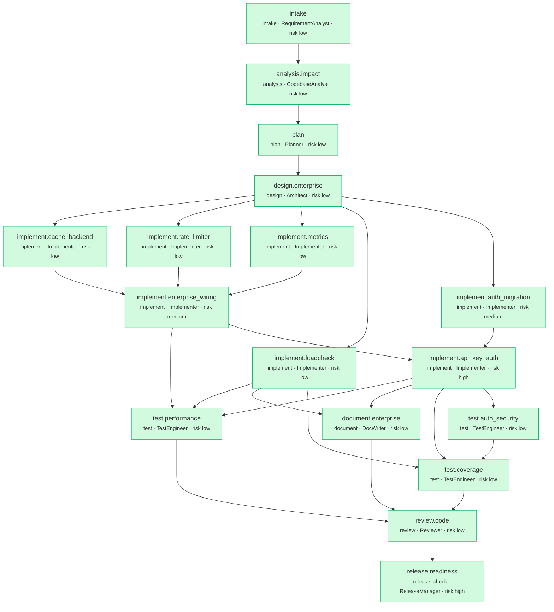

# Run report: `ambiguous-20261007T000543`

- **Scenario:** ambiguous  
- **State:** SUCCEEDED  
- **Risk class:** high  
- **Provider:** deterministic  
- **Plan version:** 2  
- **Audit chain:** intact (190 events)  
- **End-to-end latency:** 29.369s

## Requirement

**REQ-AMBIGUOUS - Make the shortener enterprise-ready and faster. Update from security review: ent** (v2, ambiguity 1.0, risk high)

> Make the shortener enterprise-ready and faster. Update from security review: enterprise-ready requires API-key authentication on all write endpoints (create, update, delete). Keys must be stored hashed and only the owning key may modify or delete a link.

Capabilities: enterprise_wiring, caching, rate_limiting, observability, performance, auth_schema, api_key_auth

| Ambiguous term | Question | Default assumption |
|---|---|---|
| enterprise-ready | Which enterprise capabilities are in scope (authentication, rate limiting, caching, observability, SSO, multi-tenancy)? | Interpret as read-through caching of redirects, per-client rate limiting and Prometheus metrics. Authentication changes the public API contract, so it is NOT assumed; it is raised as open question Q-1. |
| faster | Faster for which endpoint, by how much, and under what load? | Target the redirect hot path - p95 latency under 50 ms with 20 concurrent clients on a developer laptop (SQLite), measured by scripts/loadcheck.py and enforced as a gate. |
| secure | Which threats and controls are in scope (authn, authz, abuse prevention, audit)? | API-key authentication on writes plus rate limiting. |

Open questions: Q-2: Is there a production SLO (p95/p99, RPS) that should replace the laptop target?

Assumptions:
- [enterprise-ready] Interpret as read-through caching of redirects, per-client rate limiting and Prometheus metrics. Authentication changes the public API contract, so it is NOT assumed; it is raised as open question Q-1.
- [faster] Target the redirect hot path - p95 latency under 50 ms with 20 concurrent clients on a developer laptop (SQLite), measured by scripts/loadcheck.py and enforced as a gate.
- [secure] API-key authentication on writes plus rate limiting.
- Resolved Q-1 by requirement text: api_key_auth is in scope.

| AC | Given / When / Then | Verified by |
|---|---|---|
| AC-C1 | Given a link that was resolved once, when it is followed again, then the redirect is served from cache without a database lookup | `tests/service/test_enterprise.py::test_redirect_is_served_from_cache` |
| AC-C2 | Given a cached link, when it is disabled or deleted, then the next redirect reflects the change | `tests/service/test_enterprise.py::test_cache_is_invalidated_on_update_and_delete` |
| AC-R1 | Given a client over its rate limit, when it sends another request, then the API returns 429 with Retry-After | `tests/service/test_enterprise.py::test_rate_limit_returns_429_with_retry_after` |
| AC-O1 | Given traffic has been served, when Prometheus scrapes /metrics, then request, redirect and cache metrics are exposed | `tests/service/test_enterprise.py::test_metrics_endpoint_exposes_counters` |
| AC-P1 | Given 20 concurrent clients, when they follow links, then p95 redirect latency is under 50 ms | `gate:p95_under_target` |
| AC-A1 | Given no or an invalid X-API-Key, when a client calls a write endpoint, then the API returns 401 | `tests/service/test_auth.py::test_write_endpoints_require_a_valid_key` |
| AC-A2 | Given a link created by key A, when key B tries to modify or delete it, then the API returns 403 | `tests/service/test_auth_security.py::test_only_the_owner_can_modify_a_link` |
| AC-A3 | Given an API key, when it is stored, then only its SHA-256 hash is persisted | `tests/service/test_auth.py::test_keys_are_hashed_at_rest` |

## Plan DAG

## Timeline

| Node | Type | Agent | Risk | State | Attempts | Started | Duration |
|---|---|---|---|---|---|---|---|
| `intake` | intake | RequirementAnalyst | low | SUCCEEDED | 1 | 00:05:43 | 0.0s |
| `analysis.impact` | analysis | CodebaseAnalyst | low | SUCCEEDED | 1 | 00:05:43 | 0.3s |
| `plan` | plan | Planner | low | SUCCEEDED | 1 | 00:05:43 | 0.0s |
| `design.enterprise` | design | Architect | low | SUCCEEDED | 1 | 00:05:49 | 0.1s |
| `implement.enterprise_wiring` | implement | Implementer | medium | SUCCEEDED | 1 | 00:05:51 | 1.4s |
| `implement.cache_backend` | implement | Implementer | low | SUCCEEDED | 1 | 00:05:49 | 1.2s |
| `implement.rate_limiter` | implement | Implementer | low | SUCCEEDED | 1 | 00:05:49 | 1.2s |
| `implement.metrics` | implement | Implementer | low | SUCCEEDED | 1 | 00:05:49 | 0.9s |
| `implement.loadcheck` | implement | Implementer | low | SUCCEEDED | 1 | 00:05:49 | 0.3s |
| `test.performance` | test | TestEngineer | low | SUCCEEDED | 1 | 00:06:00 | 1.9s |
| `document.enterprise` | document | DocWriter | low | SUCCEEDED | 1 | 00:06:00 | 0.5s |
| `test.coverage` | test | TestEngineer | low | SUCCEEDED | 1 | 00:06:01 | 6.9s |
| `review.code` | review | Reviewer | low | SUCCEEDED | 1 | 00:06:08 | 0.7s |
| `release.readiness` | release_check | ReleaseManager | high | SUCCEEDED | 1 | 00:06:09 | 3.4s |
| `implement.auth_migration` | implement | Implementer | medium | SUCCEEDED | 1 | 00:05:50 | 1.7s |
| `implement.api_key_auth` | implement | Implementer | high | SUCCEEDED | 1 | 00:05:52 | 8.4s |
| `test.auth_security` | test | TestEngineer | low | SUCCEEDED | 1 | 00:06:00 | 0.9s |

## Gates

| Node | Attempt | Phase | Gate | Result | Details |
|---|---|---|---|---|---|
| `intake` | 1 | exit | has_output | PASS |  |
| `analysis.impact` | 1 | exit | has_output | PASS |  |
| `plan` | 1 | exit | has_output | PASS |  |
| `design.enterprise` | 1 | exit | has_output | PASS |  |
| `design.enterprise` | 1 | exit | has_output | PASS |  |
| `implement.cache_backend` | 1 | exit | compiles | PASS | 2 files compile |
| `implement.rate_limiter` | 1 | exit | compiles | PASS | 2 files compile |
| `implement.metrics` | 1 | exit | compiles | PASS | 2 files compile |
| `implement.cache_backend` | 1 | exit | lint_clean | PASS | ruff clean on 2 files |
| `implement.loadcheck` | 1 | exit | compiles | PASS | 1 files compile |
| `implement.rate_limiter` | 1 | exit | lint_clean | PASS | ruff clean on 2 files |
| `implement.metrics` | 1 | exit | lint_clean | PASS | ruff clean on 2 files |
| `implement.loadcheck` | 1 | exit | lint_clean | PASS | ruff clean on 1 files |
| `implement.auth_migration` | 1 | exit | compiles | PASS | 3 files compile |
| `implement.auth_migration` | 1 | exit | lint_clean | PASS | ruff clean on 3 files |
| `implement.metrics` | 1 | exit | targeted_tests | PASS | 2 passed in 0.06s [tests/service/test_metrics.py] |
| `implement.rate_limiter` | 1 | exit | targeted_tests | PASS | 8 passed in 0.30s [tests/service/test_ratelimit.py] |
| `implement.cache_backend` | 1 | exit | targeted_tests | PASS | 7 passed in 0.36s [tests/service/test_cache.py] |
| `implement.auth_migration` | 1 | exit | migrations_apply | PASS | upgrade/downgrade/upgrade round-trip succeeded |
| `implement.enterprise_wiring` | 1 | exit | compiles | PASS | 9 files compile |
| `implement.enterprise_wiring` | 1 | exit | lint_clean | PASS | ruff clean on 9 files |
| `implement.auth_migration` | 1 | exit | targeted_tests | PASS | 1 passed in 0.08s [tests/service/test_schema_v3.py] |
| `implement.enterprise_wiring` | 1 | exit | targeted_tests | PASS | 25 passed in 0.36s [tests/service/test_enterprise.py, tests/service/test_api_links.py, tests/service/test_stats_api.py] |
| `implement.api_key_auth` | 1 | exit | compiles | PASS | 11 files compile |
| `implement.api_key_auth` | 1 | exit | lint_clean | PASS | ruff clean on 11 files |
| `implement.api_key_auth` | 1 | exit | targeted_tests | PASS | 33 passed in 0.65s [tests/service/test_auth.py, tests/service/test_api_links.py, tests/service/test_integration.py, tests/service/test_enterprise.py] |
| `test.auth_security` | 1 | exit | compiles | PASS | 1 files compile |
| `test.auth_security` | 1 | exit | lint_clean | PASS | ruff clean on 1 files |
| `document.enterprise` | 1 | exit | has_output | PASS |  |
| `document.enterprise` | 1 | exit | changelog_entry | PASS | CHANGELOG has Unreleased entries |
| `test.auth_security` | 1 | exit | targeted_tests | PASS | 13 passed in 0.21s [tests/service/test_auth_security.py] |
| `test.performance` | 1 | exit | p95_under_target | PASS | p95 6.4ms <= target 50.0ms (p50 5.3ms) |
| `test.coverage` | 1 | exit | coverage:85 | PASS | coverage 97.0% >= 85% (154 passed in 5.07s) |
| `review.code` | 1 | exit | review_approved | PASS | reviewer approved (5 non-blocking findings) |
| `release.readiness` | 1 | exit | typecheck | PASS | Success: no issues found in 32 source files |
| `release.readiness` | 1 | exit | changelog_entry | PASS | CHANGELOG has Unreleased entries |
| `release.readiness` | 1 | exit | release_ready | PASS | 5 release checks passed |

## Policy results

191 evaluations; 0 non-passing.

## Approvals

| Gate | Risk | Status | Approver | Auto | Comment | Reasons |
|---|---|---|---|---|---|---|
| `intake#1` | medium | approved | auto-approver (build-agent (Claude Code, acting for repo owner)) | True | auto-approved by --auto-approve=low,medium | clarification: ambiguity score 0.65 > 0.35; proceeding on 2 documented default assumption(s) (see clarification.md): enterprise-ready -> Interpret as read-through caching of redirects, per-client rat… |
| `replan-1` | high | approved | build-agent (Claude Code, acting for repo owner) | False | Security review answered Q-1: API-key auth is in scope. Accept re-plan (adds au… | re-plan raised run risk medium -> high: Requirement v2 adds capabilities ['api_key_auth', 'auth_schema'] (risk medium -> high); design must be revisited and 3 node(s) added, 4 re-wired. |
| `implement.auth_migration#1` | medium | approved | auto-approver (build-agent (Claude Code, acting for repo owner)) | True | auto-approved by --auto-approve=low,medium | db_migration: database schema migration [service/migrations/versions/rev_0003_api_keys.py] |
| `implement.enterprise_wiring#1` | medium | approved | auto-approver (build-agent (Claude Code, acting for repo owner)) | True | auto-approved by --auto-approve=low,medium | dependency_addition: new or changed runtime dependency [pyproject.toml] |
| `implement.api_key_auth#1` | high | approved | build-agent (Claude Code, acting for repo owner) | False | Reviewed auth diff: SHA-256 at rest, constant-time compare, dummy hash for unkn… | security_sensitive: authentication / authorization / key handling change [service/auth.py]; node_risk: planner classified implement.api_key_auth as high risk |
| `release.readiness#1` | high | approved | build-agent (Claude Code, acting for repo owner) | False | Release sign-off: all checklist items green; p95 within target; high-risk chang… | release_signoff: release sign-off (risk = max(medium, run risk)) [release_check node] |

## Dynamic re-planning

- **replan-1** (plan v2): risk medium → high; added ['implement.auth_migration', 'implement.api_key_auth', 'test.auth_security'], removed [], modified ['test.performance', 'document.enterprise', 'test.coverage', 'release.readiness'], re-run ['design.enterprise', 'document.enterprise', 'release.readiness', 'test.coverage', 'test.performance']

## Notable events

| Seq | Event | Details |
|---|---|---|
| 35 | scripted_event | {"action": "amend_requirement", "after_node": "design.enterprise", "note": "answer to open question Q-1 from the security review", "source": "requirements/ambiguous.events.yaml"} |
| 36 | change_detected | {"drifted_files": {}, "new_requirement_sha256": "c559ab959d186eb20cd8aaa087df71b96b2948968124c2a6871a127826675395", "replan_id": "replan-1", "requirement_changed": true} |

## Decisions (lineage)

| Decision | Node | Agent | Parents | Rationale |
|---|---|---|---|---|
| D-ba6efeb323 | `requirement` | human |  | Requirement of record: ambiguous.txt |
| D-a1cd3031fb | `intake` | RequirementAnalyst | D-ba6efeb323 | Capabilities ['enterprise_wiring', 'caching', 'rate_limiting', 'observability', 'performance']. Ambiguities: ['enterprise-ready', 'faster']. Assumptions: 2. |
| D-23e8a2db83 | `analysis.impact` | CodebaseAnalyst | D-a1cd3031fb | Seeds ['service', 'service.api', 'service.api.health'] -> 5 impacted modules via the reverse import graph; routes from fastapi; migrations_needed=False; blast radius 0.182. |
| D-a0d8460b23 | `plan` | Planner | D-23e8a2db83 | Capabilities ['enterprise_wiring', 'caching', 'rate_limiting', 'observability', 'performance'] decomposed from the catalog. Independent work runs in parallel (implement.cache_backend, implement.loadc… |
| D-51fbd31c0e | `design.enterprise` | Architect | D-a0d8460b23 | Read-through cache of the resolved link (positive + short negative TTL): removes the DB from the hot path; negative caching blunts enumeration; Invalidate on PATCH/DELETE: correctness over hit rate f… |
| D-c2b20b29bb | `replan-1` | Planner | D-a0d8460b23 | Requirement v2 adds capabilities ['api_key_auth', 'auth_schema'] (risk medium -> high); design must be revisited and 3 node(s) added, 4 re-wired. |
| D-f12531c40e | `design.enterprise` | Architect | D-a0d8460b23 | Read-through cache of the resolved link (positive + short negative TTL): removes the DB from the hot path; negative caching blunts enumeration; Invalidate on PATCH/DELETE: correctness over hit rate f… |
| D-bc05dae184 | `implement.cache_backend` | Implementer | D-f12531c40e | One protocol, two backends: the in-memory LRU keeps the single-process default dependency-free, Redis shares state across replicas. Values are small JSON strings; TTLs are enforced per entry. |
| D-4280e6b89b | `implement.rate_limiter` | Implementer | D-f12531c40e | Token buckets allow short bursts while bounding sustained rate. The Redis variant runs the read-modify-write in a Lua script so concurrent replicas cannot double-spend tokens. |
| D-255ca01363 | `implement.metrics` | Implementer | D-f12531c40e | Labels use the route template (/{code}), never the raw path, so cardinality stays bounded. A per-app CollectorRegistry avoids global state and duplicate-registration errors in tests. |
| D-f74e53977d | `implement.loadcheck` | Implementer | D-f12531c40e | Turns "faster" into a measurable, repeatable number. Links are seeded through the service layer, the server runs as a separate process, and each concurrent worker owns its own HTTP connection so the … |
| D-d4cc46960c | `implement.auth_migration` | Implementer | D-f12531c40e | Additive and reversible. Existing links keep owner_key_id NULL (no owner) so they remain manageable after auth is enabled; new links record the creating key. |
| D-7751e76b93 | `implement.enterprise_wiring` | Implementer | D-bc05dae184, D-4280e6b89b, D-255ca01363 | Redirects resolve through a read-through cache keyed by canonical code (aliases look up their lower-case entry; only canonical misses are negatively cached), invalidated on create/update/delete. Cach… |
| D-1ee241cf41 | `implement.api_key_auth` | Implementer | D-7751e76b93, D-d4cc46960c | Opaque 256-bit keys with an indexed prefix, compared in constant time, revocable, never logged. Writes are rate limited per key. Only the creating key may PATCH/DELETE a link (403 otherwise). Redirec… |
| D-2a5d906ff8 | `test.auth_security` | TestEngineer | D-1ee241cf41 | Attack-oriented tests for the new trust boundary, independent of the implementer's own tests. |
| D-72c3cce764 | `document.enterprise` | DocWriter | D-1ee241cf41, D-f74e53977d | API reference and OpenAPI are generated from the running app, so they cannot drift from the code. |
| D-96ae3d6549 | `test.coverage` | TestEngineer | D-1ee241cf41, D-f74e53977d, D-2a5d906ff8 | Coverage is measured by the independent coverage gate, not self-reported. |
| D-6e2d7a0e4f | `test.performance` | TestEngineer | D-7751e76b93, D-f74e53977d, D-1ee241cf41 | Measured against a real uvicorn process over HTTP (not in-process). |
| D-5d394b669d | `review.code` | Reviewer | D-72c3cce764, D-96ae3d6549, D-6e2d7a0e4f | 8/8 acceptance criteria verified by passing tests; 33 files changed. |
| D-51d5e9c0ed | `release.readiness` | ReleaseManager | D-5d394b669d | REQ-AMBIGUOUS: Make the shortener enterprise-ready and faster. Update from security review: enterprise-ready requires API-key authentication on all write endpoints (create, update, delete). Keys must… |

## Metrics

| Metric | Value |
|---|---|
| node_success_rate | 1.0 |
| attempts | 18 |
| retries | 0 |
| retry_rate | 0.0 |
| rollbacks | 0 |
| rollback_frequency | 0.0 |
| fallbacks | 0 |
| fallback_frequency | 0.0 |
| mttr_s | None |
| end_to_end_latency_s | 29.369 |
| approvals | 6 |
| approvals_auto | 3 |
| approval_wait_mean_s | 2.102 |
| gates_evaluated | 55 |
| gates_failed | 0 |
| replans | 1 |
| llm_calls | 18 |
| llm_input_tokens | 32206 |
| llm_output_tokens | 32899 |
| llm_cost_usd | 0.0 |
| stage_latency_s | {'analysis': 0.324, 'design': 0.083, 'document': 0.486, 'implement': 15.048, 'intake': 0.025, 'plan': 0.013, 'release_check': 3.369, 'review': 0.718, 'test': 9.664} |

## Artifacts

| Key | Version | Producer | Files |
|---|---|---|---|
| `requirement` | 2 | `replan-1` | - |
| `baseline` | 1 | `engine` | - |
| `spec` | 2 | `replan-1` | - |
| `impact` | 1 | `analysis.impact` | - |
| `plan` | 1 | `plan` | - |
| `design` | 2 | `design.enterprise` | `docs/design/enterprise.md` |
| `changes:design.enterprise` | 2 | `design.enterprise` | `docs/design/enterprise.md` |
| `code:loadcheck` | 1 | `implement.loadcheck` | `scripts/loadcheck.py` |
| `changes:implement.loadcheck` | 1 | `implement.loadcheck` | `scripts/loadcheck.py` |
| `code:metrics` | 1 | `implement.metrics` | `service/metrics.py`, `tests/service/test_metrics.py` |
| `changes:implement.metrics` | 1 | `implement.metrics` | `service/metrics.py`, `tests/service/test_metrics.py` |
| `code:ratelimit` | 1 | `implement.rate_limiter` | `service/ratelimit.py`, `tests/service/test_ratelimit.py` |
| `changes:implement.rate_limiter` | 1 | `implement.rate_limiter` | `service/ratelimit.py`, `tests/service/test_ratelimit.py` |
| `code:cache` | 1 | `implement.cache_backend` | `service/cache.py`, `tests/service/test_cache.py` |
| `changes:implement.cache_backend` | 1 | `implement.cache_backend` | `service/cache.py`, `tests/service/test_cache.py` |
| `code:auth_schema` | 1 | `implement.auth_migration` | `service/migrations/versions/rev_0003_api_keys.py`, `tests/service/test_schema_v3.py`, `service/models.py` |
| `changes:implement.auth_migration` | 1 | `implement.auth_migration` | `service/migrations/versions/rev_0003_api_keys.py`, `tests/service/test_schema_v3.py`, `service/models.py` |
| `code:enterprise_wiring` | 1 | `implement.enterprise_wiring` | `tests/service/test_enterprise.py`, `pyproject.toml`, `service/api/deps.py`, `service/api/health.py`, `service/api/links.py`, `service/api/redirect.py` … |
| `changes:implement.enterprise_wiring` | 1 | `implement.enterprise_wiring` | `tests/service/test_enterprise.py`, `pyproject.toml`, `service/api/deps.py`, `service/api/health.py`, `service/api/links.py`, `service/api/redirect.py` … |
| `code:auth` | 1 | `implement.api_key_auth` | `service/auth.py`, `service/cli.py`, `tests/service/test_auth.py`, `service/api/deps.py`, `service/api/links.py`, `service/config.py` … |
| `changes:implement.api_key_auth` | 1 | `implement.api_key_auth` | `service/auth.py`, `service/cli.py`, `tests/service/test_auth.py`, `service/api/deps.py`, `service/api/links.py`, `service/config.py` … |
| `docs` | 1 | `document.enterprise` | `README.md`, `CHANGELOG.md`, `docs/service/API.md`, `docs/openapi.json` |
| `changes:document.enterprise` | 1 | `document.enterprise` | `README.md`, `CHANGELOG.md`, `docs/service/API.md`, `docs/openapi.json` |
| `tests:auth_security` | 1 | `test.auth_security` | `tests/service/test_auth_security.py` |
| `changes:test.auth_security` | 1 | `test.auth_security` | `tests/service/test_auth_security.py` |
| `performance` | 1 | `test.performance` | `docs/PERFORMANCE.md` |
| `changes:test.performance` | 1 | `test.performance` | `docs/PERFORMANCE.md` |
| `test_report` | 1 | `test.coverage` | - |
| `review` | 1 | `review.code` | - |
| `release` | 1 | `release.readiness` | - |

Other files in this folder: `audit.jsonl` (hash-chained), `state.db`, `decisions.json`, `metrics.json`, `traces.jsonl`, `plan.mmd`, `diffs/`, `changes.patch`, `report.html`.
