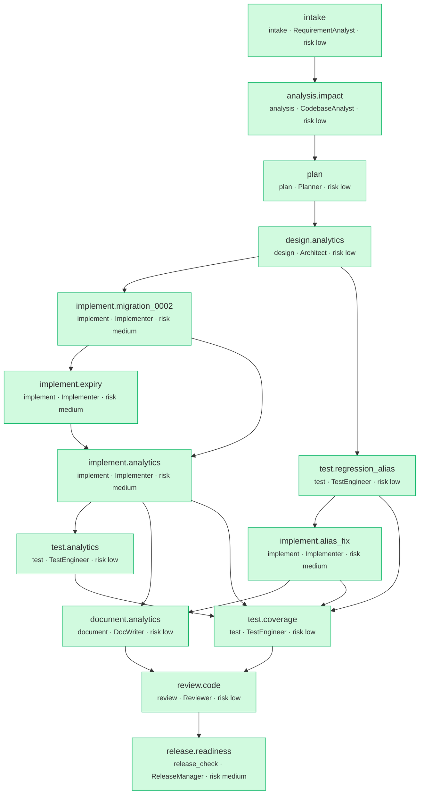

# Run report: `brownfield-20261007T002321`

- **Scenario:** brownfield  
- **State:** SUCCEEDED  
- **Risk class:** medium  
- **Provider:** deterministic  
- **Plan version:** 1  
- **Audit chain:** intact (151 events)  
- **End-to-end latency:** 14.492s

## Requirement

**REQ-BF-002 - Click analytics, link expiry and alias case bug fix** (v1, ambiguity 0.0, risk medium)

> Add click analytics (stats endpoint with daily breakdown, referrers, unique visitors) and link expiry, and fix the bug where custom aliases are case-sensitive in lookups but not in creation.

Capabilities: schema_v2, alias_case_fix, expiry, analytics

| AC | Given / When / Then | Verified by |
|---|---|---|
| AC-1 | Given a custom alias created as 'MyLink', when a client requests /MyLink or /mylink, then both redirect to the target | `tests/service/test_regression_alias_case.py::test_alias_lookup_is_case_insensitive` |
| AC-2 | Given a generated code with mixed case, when a client requests it with different casing, then only the exact code resolves | `tests/service/test_integration.py::test_generated_codes_are_case_sensitive` |
| AC-3 | Given a link with expires_at in the past, when a client follows it, then the service returns 410 and metadata reports is_expired | `tests/service/test_expiry.py::test_expired_link_returns_410` |
| AC-4 | Given several redirects from different visitors and referrers, when a client requests the stats endpoint, then totals, unique visitors, daily breakdown, referrers and user-agent families are correct | `tests/service/test_stats_api.py::test_stats_reflect_recorded_clicks` |
| AC-5 | Given the analytics store is failing, when a client follows a link, then the redirect still succeeds | `tests/service/test_stats_api.py::test_analytics_failure_never_breaks_redirect` |
| AC-6 | Given recorded clicks, when the database is inspected, then no raw IP address or user agent is stored | `tests/service/test_analytics_unit.py::test_no_raw_pii_is_persisted` |

## Plan DAG

## Timeline

| Node | Type | Agent | Risk | State | Attempts | Started | Duration |
|---|---|---|---|---|---|---|---|
| `intake` | intake | RequirementAnalyst | low | SUCCEEDED | 1 | 00:23:21 | 0.0s |
| `analysis.impact` | analysis | CodebaseAnalyst | low | SUCCEEDED | 1 | 00:23:21 | 0.3s |
| `plan` | plan | Planner | low | SUCCEEDED | 1 | 00:23:21 | 0.0s |
| `design.analytics` | design | Architect | low | SUCCEEDED | 1 | 00:23:21 | 0.1s |
| `implement.migration_0002` | implement | Implementer | medium | SUCCEEDED | 1 | 00:23:21 | 3.1s |
| `test.regression_alias` | test | TestEngineer | low | SUCCEEDED | 1 | 00:23:21 | 0.8s |
| `implement.alias_fix` | implement | Implementer | medium | SUCCEEDED | 2 | 00:23:22 | 1.9s |
| `implement.expiry` | implement | Implementer | medium | SUCCEEDED | 1 | 00:23:25 | 0.8s |
| `implement.analytics` | implement | Implementer | medium | SUCCEEDED | 1 | 00:23:25 | 0.8s |
| `test.analytics` | test | TestEngineer | low | SUCCEEDED | 1 | 00:23:26 | 0.7s |
| `document.analytics` | document | DocWriter | low | SUCCEEDED | 1 | 00:23:26 | 0.4s |
| `test.coverage` | test | TestEngineer | low | SUCCEEDED | 1 | 00:23:27 | 4.9s |
| `review.code` | review | Reviewer | low | SUCCEEDED | 1 | 00:23:32 | 0.6s |
| `release.readiness` | release_check | ReleaseManager | medium | SUCCEEDED | 1 | 00:23:32 | 3.1s |

## Gates

| Node | Attempt | Phase | Gate | Result | Details |
|---|---|---|---|---|---|
| `intake` | 1 | exit | has_output | PASS |  |
| `analysis.impact` | 1 | exit | has_output | PASS |  |
| `plan` | 1 | exit | has_output | PASS |  |
| `design.analytics` | 1 | exit | has_output | PASS |  |
| `test.regression_alias` | 1 | exit | compiles | PASS | 1 files compile |
| `test.regression_alias` | 1 | exit | lint_clean | PASS | ruff clean on 1 files |
| `implement.migration_0002` | 1 | exit | compiles | PASS | 3 files compile |
| `implement.migration_0002` | 1 | exit | lint_clean | PASS | ruff clean on 3 files |
| `test.regression_alias` | 1 | exit | tests_fail_first | PASS | regression test fails as expected before the fix: 2 failed in 0.10s |
| `implement.alias_fix` | 1 | exit | compiles | PASS | 1 files compile |
| `implement.migration_0002` | 1 | exit | migrations_apply | PASS | upgrade/downgrade/upgrade round-trip succeeded |
| `implement.alias_fix` | 1 | exit | lint_clean | PASS | ruff clean on 1 files |
| `implement.migration_0002` | 1 | exit | targeted_tests | PASS | 1 passed in 0.07s [tests/service/test_schema_v2.py] |
| `implement.alias_fix` | 1 | exit | targeted_tests | FAIL | ...F.......F.....FF [100%] =================================== FAILURES =================================== ___________________ test_generated_codes_are_case_s… |
| `implement.alias_fix` | 2 | exit | compiles | PASS | 1 files compile |
| `implement.alias_fix` | 2 | exit | lint_clean | PASS | ruff clean on 1 files |
| `implement.alias_fix` | 2 | exit | targeted_tests | PASS | 19 passed in 0.26s [tests/service/test_regression_alias_case.py, tests/service/test_integration.py, tests/service/test_api_links.py] |
| `implement.expiry` | 1 | exit | compiles | PASS | 3 files compile |
| `implement.expiry` | 1 | exit | lint_clean | PASS | ruff clean on 3 files |
| `implement.expiry` | 1 | exit | targeted_tests | PASS | 13 passed in 0.15s [tests/service/test_expiry.py, tests/service/test_api_links.py] |
| `implement.analytics` | 1 | exit | compiles | PASS | 6 files compile |
| `implement.analytics` | 1 | exit | lint_clean | PASS | ruff clean on 6 files |
| `implement.analytics` | 1 | exit | targeted_tests | PASS | 14 passed in 0.10s [tests/service/test_analytics_unit.py] |
| `test.analytics` | 1 | exit | compiles | PASS | 1 files compile |
| `test.analytics` | 1 | exit | lint_clean | PASS | ruff clean on 1 files |
| `document.analytics` | 1 | exit | has_output | PASS |  |
| `document.analytics` | 1 | exit | changelog_entry | PASS | CHANGELOG has Unreleased entries |
| `test.analytics` | 1 | exit | targeted_tests | PASS | 5 passed in 0.12s [tests/service/test_stats_api.py] |
| `test.coverage` | 1 | exit | coverage:85 | PASS | coverage 97.0% >= 85% (108 passed in 3.38s) |
| `review.code` | 1 | exit | review_approved | PASS | reviewer approved (0 non-blocking findings) |
| `release.readiness` | 1 | exit | typecheck | PASS | Success: no issues found in 26 source files |
| `release.readiness` | 1 | exit | changelog_entry | PASS | CHANGELOG has Unreleased entries |
| `release.readiness` | 1 | exit | release_ready | PASS | 5 release checks passed |

## Policy results

158 evaluations; 0 non-passing.

## Approvals

| Gate | Risk | Status | Approver | Auto | Comment | Reasons |
|---|---|---|---|---|---|---|
| `implement.migration_0002#1` | medium | approved | build-agent (Claude Code, acting for repo owner) | False | Reviewed: additive only (nullable column, new table, indexes); downgrade revers… | db_migration: database schema migration [service/migrations/versions/rev_0002_clicks_and_expiry.py] |
| `release.readiness#1` | medium | approved | build-agent (Claude Code, acting for repo owner) | False | Release checklist all green (criteria verified, coverage, migrations round-trip… | release_signoff: release sign-off (risk = max(medium, run risk)) [release_check node] |

## Notable events

| Seq | Event | Details |
|---|---|---|
| 66 | rollback | {"attempt": 1, "node_id": "implement.alias_fix", "paths": ["service/repository.py"]} |
| 68 | retry_scheduled | {"attempt": 1, "delay_s": 0.0223870042491378, "node_id": "implement.alias_fix"} |

## Decisions (lineage)

| Decision | Node | Agent | Parents | Rationale |
|---|---|---|---|---|
| D-45ad2e0471 | `requirement` | human |  | Requirement of record: brownfield.yaml |
| D-d00ef83eca | `intake` | RequirementAnalyst | D-45ad2e0471 | Capabilities ['schema_v2', 'alias_case_fix', 'expiry', 'analytics']. Ambiguities: none. Assumptions: 0. |
| D-dfcb4eecce | `analysis.impact` | CodebaseAnalyst | D-d00ef83eca | Seeds ['service.api.links', 'service.api.redirect', 'service.domain.codes', 'service.models', 'service.repository'] -> 10 impacted modules via the reverse import graph; routes from fastapi; migration… |
| D-d29fcbbc81 | `plan` | Planner | D-dfcb4eecce | Capabilities ['schema_v2', 'alias_case_fix', 'expiry', 'analytics'] decomposed from the catalog. Independent work runs in parallel (implement.migration_0002, test.regression_alias); tests and docs br… |
| D-a5f63b6dd7 | `design.analytics` | Architect | D-d29fcbbc81 | Exact match first, then lower-cased match restricted to is_custom rows: keeps generated base62 codes case-sensitive while making aliases case-insensitive; Expiry evaluated at read time: no background… |
| D-503eef95a1 | `implement.migration_0002` | Implementer | D-a5f63b6dd7 | Additive and reversible: a nullable column and a new table with a composite (link_id, day) index for the stats queries. SQLite needs batch mode for ALTER, Postgres does not; env.py selects it. The cl… |
| D-8e3acea809 | `test.regression_alias` | TestEngineer | D-a5f63b6dd7 | Test-first bug fix. Creates an alias as 'MyLink' and asserts it resolves at /MyLink, /mylink and /MYLINK and via the metadata endpoint. The tests_fail_first gate proves it reproduces the bug (fails w… |
| D-effa43b000 | `implement.alias_fix` | Implementer | D-8e3acea809 | Aliases are stored lower case, so normalising the requested code to lower case makes alias lookups case-insensitive. |
| D-38fdc50025 | `implement.alias_fix` | Implementer | D-8e3acea809 | Exact match first keeps generated base62 codes case-sensitive; only when that misses and the requested code is not already lower case do we look up the canonical alias, restricted to is_custom rows. … |
| D-41d730bf66 | `implement.expiry` | Implementer | D-503eef95a1 | Expiry is evaluated at read time against UTC now, so no scheduler is required and behaviour is exact. expires_at must be timezone-aware and in the future; PATCH with null clears it. |
| D-4e2d243e46 | `implement.analytics` | Implementer | D-41d730bf66, D-503eef95a1 | The redirect only enqueues (put_nowait) and never awaits analytics I/O; a background writer batches inserts and a purger enforces analytics_retention_days. Unique visitors use a daily-salted HMAC so … |
| D-c101f0be8a | `test.analytics` | TestEngineer | D-4e2d243e46 | Uses per-request client addresses through the ASGI transport to simulate distinct visitors and proves that both enqueue failures and database failures leave redirects unaffected. |
| D-e61e73056d | `document.analytics` | DocWriter | D-38fdc50025, D-4e2d243e46 | API reference and OpenAPI are generated from the running app, so they cannot drift from the code. |
| D-6ef176a836 | `test.coverage` | TestEngineer | D-38fdc50025, D-4e2d243e46, D-c101f0be8a, D-8e3acea809 | Coverage is measured by the independent coverage gate, not self-reported. |
| D-72bac2d19c | `review.code` | Reviewer | D-e61e73056d, D-6ef176a836 | 6/6 acceptance criteria verified by passing tests; 20 files changed. |
| D-e61d77782e | `release.readiness` | ReleaseManager | D-72bac2d19c | REQ-BF-002: Add click analytics (stats endpoint with daily breakdown, referrers, unique visitors) and link expiry, and fix the bug where custom aliases are case-sensitive in lookups but not in creati… |

## Metrics

| Metric | Value |
|---|---|
| node_success_rate | 1.0 |
| attempts | 15 |
| retries | 1 |
| retry_rate | 0.0667 |
| rollbacks | 1 |
| rollback_frequency | 0.1111 |
| fallbacks | 0 |
| fallback_frequency | 0.0 |
| mttr_s | 0.938 |
| end_to_end_latency_s | 14.492 |
| approvals | 2 |
| approvals_auto | 0 |
| approval_wait_mean_s | 0.798 |
| gates_evaluated | 47 |
| gates_failed | 1 |
| replans | 0 |
| llm_calls | 14 |
| llm_input_tokens | 12647 |
| llm_output_tokens | 16077 |
| llm_cost_usd | 0.0 |
| stage_latency_s | {'analysis': 0.31, 'design': 0.07, 'document': 0.424, 'implement': 6.638, 'intake': 0.024, 'plan': 0.013, 'release_check': 3.054, 'review': 0.612, 'test': 6.376} |

## Artifacts

| Key | Version | Producer | Files |
|---|---|---|---|
| `requirement` | 1 | `human` | - |
| `baseline` | 1 | `engine` | - |
| `spec` | 1 | `intake` | - |
| `impact` | 1 | `analysis.impact` | - |
| `plan` | 1 | `plan` | - |
| `design` | 1 | `design.analytics` | `docs/design/analytics.md` |
| `changes:design.analytics` | 1 | `design.analytics` | `docs/design/analytics.md` |
| `tests:regression_alias` | 1 | `test.regression_alias` | `tests/service/test_regression_alias_case.py` |
| `changes:test.regression_alias` | 1 | `test.regression_alias` | `tests/service/test_regression_alias_case.py` |
| `code:alias_fix` | 1 | `implement.alias_fix` | `service/repository.py` |
| `changes:implement.alias_fix` | 1 | `implement.alias_fix` | `service/repository.py` |
| `code:schema_v2` | 1 | `implement.migration_0002` | `service/migrations/versions/rev_0002_clicks_and_expiry.py`, `tests/service/test_schema_v2.py`, `service/models.py` |
| `changes:implement.migration_0002` | 1 | `implement.migration_0002` | `service/migrations/versions/rev_0002_clicks_and_expiry.py`, `tests/service/test_schema_v2.py`, `service/models.py` |
| `code:expiry` | 1 | `implement.expiry` | `tests/service/test_expiry.py`, `service/links.py`, `service/schemas.py` |
| `changes:implement.expiry` | 1 | `implement.expiry` | `tests/service/test_expiry.py`, `service/links.py`, `service/schemas.py` |
| `code:analytics` | 1 | `implement.analytics` | `service/analytics.py`, `service/api/stats.py`, `tests/service/test_analytics_unit.py`, `service/api/redirect.py`, `service/app.py`, `service/config.py` |
| `changes:implement.analytics` | 1 | `implement.analytics` | `service/analytics.py`, `service/api/stats.py`, `tests/service/test_analytics_unit.py`, `service/api/redirect.py`, `service/app.py`, `service/config.py` |
| `docs` | 1 | `document.analytics` | `README.md`, `CHANGELOG.md`, `docs/service/API.md`, `docs/openapi.json` |
| `changes:document.analytics` | 1 | `document.analytics` | `README.md`, `CHANGELOG.md`, `docs/service/API.md`, `docs/openapi.json` |
| `tests:analytics` | 1 | `test.analytics` | `tests/service/test_stats_api.py` |
| `changes:test.analytics` | 1 | `test.analytics` | `tests/service/test_stats_api.py` |
| `test_report` | 1 | `test.coverage` | - |
| `review` | 1 | `review.code` | - |
| `release` | 1 | `release.readiness` | - |

Other files in this folder: `audit.jsonl` (hash-chained), `state.db`, `decisions.json`, `metrics.json`, `traces.jsonl`, `plan.mmd`, `diffs/`, `changes.patch`, `report.html`.
