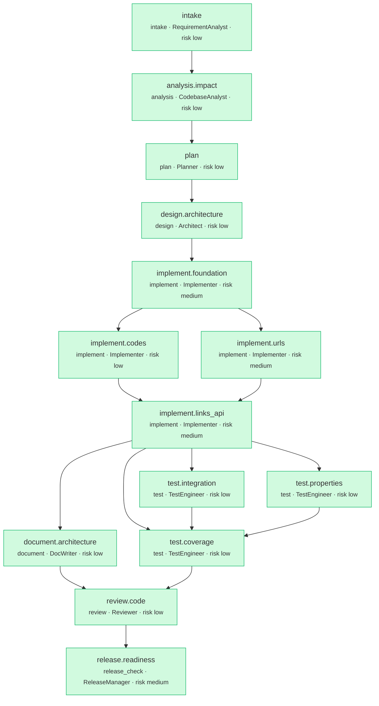

# Run report: `greenfield-20261007T000413`

- **Scenario:** greenfield  
- **State:** SUCCEEDED  
- **Risk class:** medium  
- **Provider:** deterministic  
- **Plan version:** 1  
- **Audit chain:** intact (130 events)  
- **End-to-end latency:** 11.583s

## Requirement

**REQ-GF-001 - URL shortener core service** (v1, ambiguity 0.0, risk medium)

> Build a URL shortener with create, redirect, metadata and health endpoints, persistence and tests.

Capabilities: core

| AC | Given / When / Then | Verified by |
|---|---|---|
| AC-1 | Given a valid https URL, when a client POSTs it to /api/v1/links, then the API returns 201 with code, short_url and created_at | `tests/service/test_api_links.py::test_create_returns_201_with_short_url` |
| AC-2 | Given an existing short code, when a client requests GET /{code}, then the service redirects with 302 to the stored target and Cache-Control no-store | `tests/service/test_api_links.py::test_redirect_follows_with_302_and_no_store` |
| AC-3 | Given an unknown code, when a client requests GET /{code}, then the service returns 404 using the error envelope | `tests/service/test_api_links.py::test_unknown_code_is_404` |
| AC-4 | Given a javascript:, private-network or malformed URL, when a client tries to shorten it, then the API rejects it with 422 | `tests/service/test_api_links.py::test_invalid_urls_are_rejected_with_422` `tests/service/test_properties.py::test_dangerous_schemes_always_rejected` |
| AC-5 | Given the same Idempotency-Key and body sent twice, when both requests complete, then exactly one link exists and the second response is a replay | `tests/service/test_api_links.py::test_idempotency_key_replays_and_detects_misuse` `tests/service/test_integration.py::test_concurrent_idempotent_requests_create_one_link` |
| AC-6 | Given a disabled or deleted link, when a client follows it, then the service returns 410 Gone | `tests/service/test_api_links.py::test_metadata_patch_and_soft_delete` |
| AC-7 | Given the service is running, when probes call /healthz and /readyz, then they report liveness and database readiness | `tests/service/test_health.py::test_liveness` `tests/service/test_health.py::test_readiness_ok_and_failing_database` |
| AC-8 | Given the migration history, when it is upgraded, downgraded and upgraded again, then every step succeeds | `tests/service/test_integration.py::test_migrations_upgrade_and_downgrade_cleanly` |

## Plan DAG

## Timeline

| Node | Type | Agent | Risk | State | Attempts | Started | Duration |
|---|---|---|---|---|---|---|---|
| `intake` | intake | RequirementAnalyst | low | SUCCEEDED | 1 | 00:04:14 | 0.0s |
| `analysis.impact` | analysis | CodebaseAnalyst | low | SUCCEEDED | 1 | 00:04:14 | 0.0s |
| `plan` | plan | Planner | low | SUCCEEDED | 1 | 00:04:14 | 0.0s |
| `design.architecture` | design | Architect | low | SUCCEEDED | 1 | 00:04:14 | 0.1s |
| `implement.foundation` | implement | Implementer | medium | SUCCEEDED | 1 | 00:04:14 | 1.8s |
| `implement.codes` | implement | Implementer | low | SUCCEEDED | 1 | 00:04:15 | 0.8s |
| `implement.urls` | implement | Implementer | medium | SUCCEEDED | 1 | 00:04:15 | 0.8s |
| `implement.links_api` | implement | Implementer | medium | SUCCEEDED | 1 | 00:04:16 | 0.9s |
| `test.properties` | test | TestEngineer | low | SUCCEEDED | 1 | 00:04:17 | 1.5s |
| `test.integration` | test | TestEngineer | low | SUCCEEDED | 1 | 00:04:17 | 0.8s |
| `document.architecture` | document | DocWriter | low | SUCCEEDED | 1 | 00:04:17 | 0.5s |
| `test.coverage` | test | TestEngineer | low | SUCCEEDED | 1 | 00:04:19 | 3.0s |
| `review.code` | review | Reviewer | low | SUCCEEDED | 1 | 00:04:22 | 0.7s |
| `release.readiness` | release_check | ReleaseManager | medium | SUCCEEDED | 1 | 00:04:22 | 2.7s |

## Gates

| Node | Attempt | Phase | Gate | Result | Details |
|---|---|---|---|---|---|
| `intake` | 1 | exit | has_output | PASS |  |
| `analysis.impact` | 1 | exit | has_output | PASS |  |
| `plan` | 1 | exit | has_output | PASS |  |
| `design.architecture` | 1 | exit | has_output | PASS |  |
| `implement.foundation` | 1 | exit | compiles | PASS | 20 files compile |
| `implement.foundation` | 1 | exit | lint_clean | PASS | ruff clean on 20 files |
| `implement.foundation` | 1 | exit | migrations_apply | PASS | upgrade/downgrade/upgrade round-trip succeeded |
| `implement.foundation` | 1 | exit | targeted_tests | PASS | 11 passed in 0.19s [tests/service/test_health.py] |
| `implement.codes` | 1 | exit | compiles | PASS | 2 files compile |
| `implement.urls` | 1 | exit | compiles | PASS | 2 files compile |
| `implement.codes` | 1 | exit | lint_clean | PASS | ruff clean on 2 files |
| `implement.urls` | 1 | exit | lint_clean | PASS | ruff clean on 2 files |
| `implement.codes` | 1 | exit | targeted_tests | PASS | 20 passed in 0.05s [tests/service/test_codes.py] |
| `implement.urls` | 1 | exit | targeted_tests | PASS | 26 passed in 0.05s [tests/service/test_urls.py] |
| `implement.links_api` | 1 | exit | compiles | PASS | 8 files compile |
| `implement.links_api` | 1 | exit | lint_clean | PASS | ruff clean on 8 files |
| `implement.links_api` | 1 | exit | targeted_tests | PASS | 9 passed in 0.13s [tests/service/test_api_links.py] |
| `test.properties` | 1 | exit | compiles | PASS | 1 files compile |
| `test.integration` | 1 | exit | compiles | PASS | 1 files compile |
| `test.properties` | 1 | exit | lint_clean | PASS | ruff clean on 1 files |
| `test.integration` | 1 | exit | lint_clean | PASS | ruff clean on 1 files |
| `document.architecture` | 1 | exit | has_output | PASS |  |
| `document.architecture` | 1 | exit | changelog_entry | PASS | CHANGELOG has Unreleased entries |
| `test.integration` | 1 | exit | targeted_tests | PASS | 8 passed in 0.19s [tests/service/test_integration.py] |
| `test.properties` | 1 | exit | targeted_tests | PASS | 7 passed in 0.90s [tests/service/test_properties.py] |
| `test.coverage` | 1 | exit | coverage:85 | PASS | coverage 96.0% >= 85% (81 passed in 1.60s) |
| `review.code` | 1 | exit | review_approved | PASS | reviewer approved (1 non-blocking findings) |
| `release.readiness` | 1 | exit | typecheck | PASS | Success: no issues found in 23 source files |
| `release.readiness` | 1 | exit | changelog_entry | PASS | CHANGELOG has Unreleased entries |
| `release.readiness` | 1 | exit | release_ready | PASS | 5 release checks passed |

## Policy results

147 evaluations; 0 non-passing.

## Approvals

| Gate | Risk | Status | Approver | Auto | Comment | Reasons |
|---|---|---|---|---|---|---|
| `implement.foundation#1` | medium | approved | auto-approver (build-agent (Claude Code, acting for repo owner)) | True | auto-approved by --auto-approve=low,medium | db_migration: database schema migration [service/migrations/versions/__init__.py, service/migrations/versions/rev_0001_initial.py]; dependency_addition: new or changed runtime dependency [pyproject.t… |
| `release.readiness#1` | medium | approved | auto-approver (build-agent (Claude Code, acting for repo owner)) | True | auto-approved by --auto-approve=low,medium | release_signoff: release sign-off (risk = max(medium, run risk)) [release_check node] |

## Decisions (lineage)

| Decision | Node | Agent | Parents | Rationale |
|---|---|---|---|---|
| D-9a44ea8415 | `requirement` | human |  | Requirement of record: greenfield.yaml |
| D-f4ed2bcd4f | `intake` | RequirementAnalyst | D-9a44ea8415 | Capabilities ['core']. Ambiguities: none. Assumptions: 0. |
| D-0f9cc84f7b | `analysis.impact` | CodebaseAnalyst | D-f4ed2bcd4f | Seeds [] -> 0 impacted modules via the reverse import graph; routes from none; migrations_needed=False; blast radius 0.0. |
| D-08f229a332 | `plan` | Planner | D-0f9cc84f7b | Capabilities ['core'] decomposed from the catalog. Independent work runs in parallel (implement.codes, implement.foundation, implement.urls); tests and docs branch after implementation and join at re… |
| D-47e6c8d435 | `design.architecture` | Architect | D-08f229a332 | 302 by default (307 configurable): 301 is cached forever by browsers, breaking disable/delete and analytics; 7-char random base62 codes with bounded retry: 62^7 = 3.5e12; per-insert collision p = n/6… |
| D-9ed9f9db4f | `implement.foundation` | Implementer | D-47e6c8d435 | Everything the feature nodes share is built first so they can proceed in parallel: pydantic-settings config (12-factor, SHORTENER_ prefix), SQLAlchemy 2.0 async engine with a UTC-safe datetime type, … |
| D-f8b04fb1ad | `implement.codes` | Implementer | D-9ed9f9db4f | 7 random base62 characters give 62^7 = 3.5e12 codes; per-insert collision probability is n/62^7, so a bounded retry (5) plus the DB unique constraint is sufficient and avoids a central counter. Alias… |
| D-3af91422c4 | `implement.urls` | Implementer | D-9ed9f9db4f | Shorteners are abused for phishing and SSRF-style probing. Only http/https are accepted, embedded credentials are rejected, private/loopback/link-local IP literals and local host names are refused by… |
| D-f72e40b7e2 | `implement.links_api` | Implementer | D-f8b04fb1ad, D-3af91422c4 | LinkService holds the use cases; the repository isolates SQL. Create supports Idempotency-Key with a request fingerprint (replay returns the original link, misuse returns 409). Redirect returns 302 b… |
| D-1c7c77c3ae | `test.properties` | TestEngineer | D-f72e40b7e2 | Hypothesis explores input spaces that example tests miss (unicode, huge integers, odd schemes). |
| D-0abf829022 | `test.integration` | TestEngineer | D-f72e40b7e2 | Exercises the API end-to-end against a real migrated SQLite database, including the concurrency and retry paths that unit tests cannot reach, and proves migrations upgrade/downgrade cleanly. |
| D-e013c8f3b0 | `document.architecture` | DocWriter | D-f72e40b7e2 | API reference and OpenAPI are generated from the running app, so they cannot drift from the code. |
| D-021f8a9ed2 | `test.coverage` | TestEngineer | D-f72e40b7e2, D-0abf829022, D-1c7c77c3ae | Coverage is measured by the independent coverage gate, not self-reported. |
| D-f6523404ce | `review.code` | Reviewer | D-e013c8f3b0, D-021f8a9ed2 | 8/8 acceptance criteria verified by passing tests; 40 files changed. |
| D-725402d45e | `release.readiness` | ReleaseManager | D-f6523404ce | REQ-GF-001: Build a URL shortener with create, redirect, metadata and health endpoints, persistence and tests. |

## Metrics

| Metric | Value |
|---|---|
| node_success_rate | 1.0 |
| attempts | 14 |
| retries | 0 |
| retry_rate | 0.0 |
| rollbacks | 0 |
| rollback_frequency | 0.0 |
| fallbacks | 0 |
| fallback_frequency | 0.0 |
| mttr_s | None |
| end_to_end_latency_s | 11.583 |
| approvals | 2 |
| approvals_auto | 2 |
| approval_wait_mean_s | 0.0 |
| gates_evaluated | 44 |
| gates_failed | 0 |
| replans | 0 |
| llm_calls | 13 |
| llm_input_tokens | 9492 |
| llm_output_tokens | 23529 |
| llm_cost_usd | 0.0 |
| stage_latency_s | {'analysis': 0.006, 'design': 0.07, 'document': 0.459, 'implement': 4.221, 'intake': 0.025, 'plan': 0.013, 'release_check': 2.656, 'review': 0.678, 'test': 5.42} |

## Artifacts

| Key | Version | Producer | Files |
|---|---|---|---|
| `requirement` | 1 | `human` | - |
| `baseline` | 1 | `engine` | - |
| `spec` | 1 | `intake` | - |
| `impact` | 1 | `analysis.impact` | - |
| `plan` | 1 | `plan` | - |
| `design` | 1 | `design.architecture` | `docs/design/architecture.md` |
| `changes:design.architecture` | 1 | `design.architecture` | `docs/design/architecture.md` |
| `code:foundation` | 1 | `implement.foundation` | `service/__init__.py`, `service/alembic.ini`, `service/api/__init__.py`, `service/api/deps.py`, `service/api/health.py`, `service/api/middleware.py` … |
| `changes:implement.foundation` | 1 | `implement.foundation` | `service/__init__.py`, `service/alembic.ini`, `service/api/__init__.py`, `service/api/deps.py`, `service/api/health.py`, `service/api/middleware.py` … |
| `code:codes` | 1 | `implement.codes` | `service/domain/codes.py`, `tests/service/test_codes.py` |
| `changes:implement.codes` | 1 | `implement.codes` | `service/domain/codes.py`, `tests/service/test_codes.py` |
| `code:urls` | 1 | `implement.urls` | `service/domain/urls.py`, `tests/service/test_urls.py` |
| `changes:implement.urls` | 1 | `implement.urls` | `service/domain/urls.py`, `tests/service/test_urls.py` |
| `code:links_api` | 1 | `implement.links_api` | `service/api/links.py`, `service/api/redirect.py`, `service/links.py`, `service/repository.py`, `service/schemas.py`, `tests/service/test_api_links.py` … |
| `changes:implement.links_api` | 1 | `implement.links_api` | `service/api/links.py`, `service/api/redirect.py`, `service/links.py`, `service/repository.py`, `service/schemas.py`, `tests/service/test_api_links.py` … |
| `docs` | 1 | `document.architecture` | `README.md`, `CHANGELOG.md`, `docs/service/API.md`, `docs/openapi.json` |
| `changes:document.architecture` | 1 | `document.architecture` | `README.md`, `CHANGELOG.md`, `docs/service/API.md`, `docs/openapi.json` |
| `tests:integration` | 1 | `test.integration` | `tests/service/test_integration.py` |
| `changes:test.integration` | 1 | `test.integration` | `tests/service/test_integration.py` |
| `tests:properties` | 1 | `test.properties` | `tests/service/test_properties.py` |
| `changes:test.properties` | 1 | `test.properties` | `tests/service/test_properties.py` |
| `test_report` | 1 | `test.coverage` | - |
| `review` | 1 | `review.code` | - |
| `release` | 1 | `release.readiness` | - |

Other files in this folder: `audit.jsonl` (hash-chained), `state.db`, `decisions.json`, `metrics.json`, `traces.jsonl`, `plan.mmd`, `diffs/`, `changes.patch`, `report.html`.
